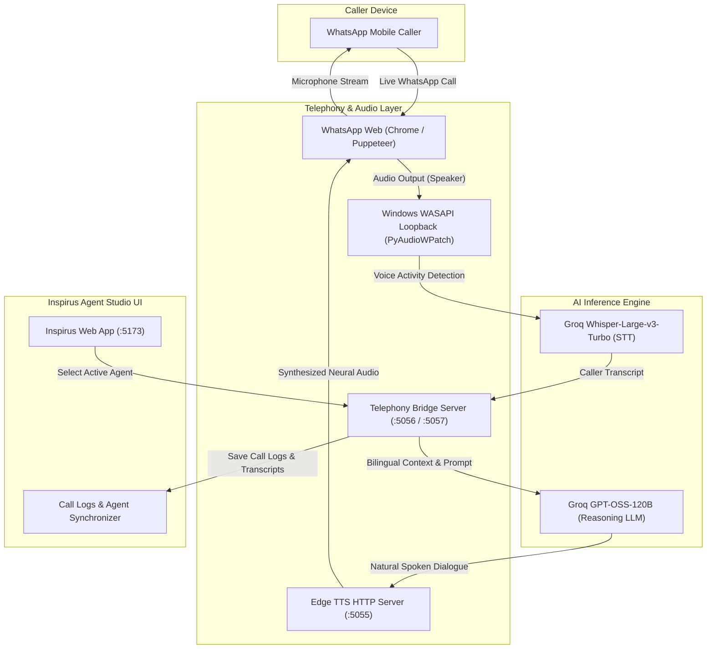

# ⚡ Inspirus Voice AI — Multi-Tenant Agent Studio & WhatsApp Telephony Gateway

> **Enterprise-Grade Conversational Voice AI Platform** featuring Real-Time Dual-Stream WASAPI Loopback Telephony, Sub-200ms Bilingual Neural STT, 90ms Conversational Reasoning, and Dynamic Multi-Tenant Agent Management.

[](https://vitejs.dev/)
[](https://nodejs.org/)
[](https://python.org/)
[](https://groq.com/)
[](https://github.com/rany2/edge-tts)

---

## 🌟 Overview

**Inspirus Voice AI** is a real-time voice automation ecosystem designed for high-throughput contact centers, clinics, emergency dispatchers, and concierge services. It bridges a modern web-based **Agent Studio** with a live **WhatsApp Telephony Gateway**, enabling AI voice agents to autonomously answer incoming WhatsApp phone calls, hold natural human-like conversations, answer queries directly, execute business tools, and record detailed Call Detail Records (CDRs).

---

## 🚀 Key Features

* **Real-Time Dual-Stream WASAPI Loopback Telephony**
  Direct hardware-level audio driver tap using Windows WASAPI loopback (`PyAudioWPatch`), capturing caller audio across any connected device (speakers, Bluetooth headphones, audio interfaces) without virtual audio cables.
* **Sub-200ms Domain-Prompted Neural STT**
  Powered by Groq's `whisper-large-v3-turbo` with bilingual Hindi/English vocabulary priors, guaranteeing zero phonetic mistranslations and clean Devanagari Hindi / Latin English transcriptions.
* **Ultra-Fast Conversational Reasoning (90ms Latency)**
  Powered by Groq `openai/gpt-oss-120b`. Configured for natural phone cadence, direct query answering, zero robotic loops, and strict conversational rules.
* **Bidirectional Dynamic Language Switching (English $\leftrightarrow$ Hindi)**
  Call greetings begin in **English** (primary). The gateway automatically detects when a caller speaks in Hindi or Hinglish and switches immediately to natural Hindi with correct grammatical inflections, switching back seamlessly if the caller switches to English.
* **Gender-Accurate Voice Assignment**
  Automatically detects agent gender from persona and name, dynamically assigning high-fidelity neural voices:
  * **Female Agents** (e.g., Maya, Elena, Nova): `en-US-JennyNeural` (English) / `hi-IN-SwaraNeural` (Hindi)
  * **Male Agents** (e.g., Carlos, Julian, Rex, Saiesh): `en-US-GuyNeural` (English) / `hi-IN-MadhurNeural` (Hindi)
* **Single-Speaker Acoustic Lock (Anti-Echo)**
  Guarantees zero voice overlap and prevents the AI's own voice from triggering false transcripts or feedback loops during speech output.
* **Direct WebRTC Mic Audio Injection**
  Hooks directly into WhatsApp WebRTC media stream pipelines in Chrome, transmitting high-fidelity synthesized speech directly to the caller's phone.
* **Full Multi-Tenant Studio UI**
  * **Agent Architect**: Visual agent builder with personality, tone, prompt, tools, and voice customization.
  * **Live Telephony Operations**: Live agent assignment dropdown, call status, and monitoring.
  * **Call Detail Records (CDRs)**: Transcripts, latency tracking, sentiment analysis, and audio player.
  * **Analytics & Campaigns**: Call volumes, resolution rates, and outbound campaign lists.

---

## 🏗️ Architecture



---

## 🛠️ Tech Stack

* **Frontend**: HTML5, Vanilla JavaScript (ES Modules), Custom Design System, CSS3 Glassmorphism, Vite.
* **Backend Gateway**: Node.js (ESM), Puppeteer with Remote Debugging protocol (port `9222`).
* **Audio Engine**: Python 3.10+, `PyAudioWPatch` (Windows WASAPI loopback tap), `numpy`.
* **Speech Synthesis (TTS)**: Microsoft Edge Neural TTS (`edge-tts`).
* **Speech Recognition (STT)**: Groq Cloud API (`whisper-large-v3-turbo`).
* **Conversational Intelligence (LLM)**: Groq Cloud API (`openai/gpt-oss-120b`).

---

## 📋 Prerequisites

1. **Windows 10 / 11** (required for WASAPI loopback audio drivers).
2. **Node.js 18.0+** ([Download](https://nodejs.org/))
3. **Python 3.10+** ([Download](https://python.org/))
4. **Google Chrome** installed.
5. **Groq Cloud API Key** ([Get free key](https://console.groq.com/keys))

---

## ⚡ Quick Start Guide

### 1. Clone the Repository
```bash
git clone https://github.com/suyashparulekar9890nova-netizen/insp.git
cd insp
```

### 2. Install Dependencies

**Node.js dependencies:**
```bash
npm install
```

**Python audio dependencies:**
```bash
pip install -r requirements.txt
```

### 3. Configure Environment Variables
Copy `.env.example` to `.env` and insert your Groq API key:
```bash
cp .env.example .env
```
Edit `.env`:
```env
VITE_GROQ_API_KEY=gsk_your_actual_groq_api_key_here
GROQ_API_KEY=gsk_your_actual_groq_api_key_here
```

---

## 🖥️ Running the Platform

To run the complete system, start the three modular services:

### Step 1: Start Edge TTS Engine (Port 5055)
```bash
npm run tts
```
*(Provides local sub-second neural voice synthesis)*

### Step 2: Start Inspirus Studio Web UI (Port 5173)
In a new terminal:
```bash
npm run dev
```
Open [http://localhost:5173](http://localhost:5173) in your browser.

### Step 3: Launch Chrome with Remote Debugging & WhatsApp Web
Start Google Chrome with debugging port `9222` enabled:
```powershell
& "C:\Program Files\Google\Chrome\Application\chrome.exe" --remote-debugging-port=9222 --user-data-dir="$env:LOCALAPPDATA\Google\Chrome\User Data" https://web.whatsapp.com/
```
Ensure your WhatsApp account is logged in and ready.

### Step 4: Start WhatsApp Telephony Gateway
In a third terminal:
```bash
npm run whatsapp:start
```
The gateway will:
1. Connect to your active Chrome WhatsApp session.
2. Hook Windows WASAPI loopback drivers.
3. Synchronize with the selected agent in Inspirus Studio (`agent-maya`, `agent-carlos`, etc.).
4. Automatically answer incoming calls and speak in real time.

---

## 📁 Repository Structure

```
insp/
├── public/                 # Static branding assets and web icons
├── server/
│   ├── tts_server.py       # High-performance Edge TTS HTTP streaming server
│   ├── wasapi_loopback.py  # Multi-device Windows WASAPI loopback VAD & STT listener
│   └── whatsapp_caller.js  # Core WebRTC Puppeteer gateway & Groq reasoning engine
├── src/
│   ├── components/         # Modular Studio UI views (Agent Studio, Telephony, Logs)
│   │   ├── AgentArchitectModal.js
│   │   ├── AgentStudioView.js
│   │   ├── CallLogsView.js
│   │   ├── DashboardView.js
│   │   ├── LiveCallModal.js
│   │   └── TelephonyView.js
│   ├── data/               # Default agents and mock tenant workspace data
│   ├── main.js             # Frontend SPA application bootstrap
│   └── style.css           # Premium glassmorphic dark-theme styling
├── .env.example            # Environment configuration template
├── .gitignore              # Strict ignore rules (protects credentials & sessions)
├── index.html              # Main single-page application entrypoint
├── package.json            # Node.js project manifests and scripts
├── requirements.txt        # Python package requirements
├── vite.config.js          # Vite build and dev-server configuration
└── README.md               # Complete platform documentation
```

---

## 🔒 Security & Privacy

* **Zero Credentials in Git**: Local session tokens, WhatsApp cookies (`whatsapp_chrome_profile/`), and `.env` files are strictly excluded via `.gitignore`.
* **Acoustic Privacy**: The system only processes audio during active phone calls when voice activity energy is detected.

---

## 📄 License

This project is licensed under the [MIT License](LICENSE).
